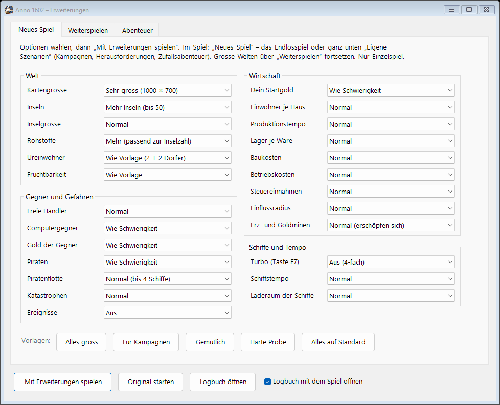
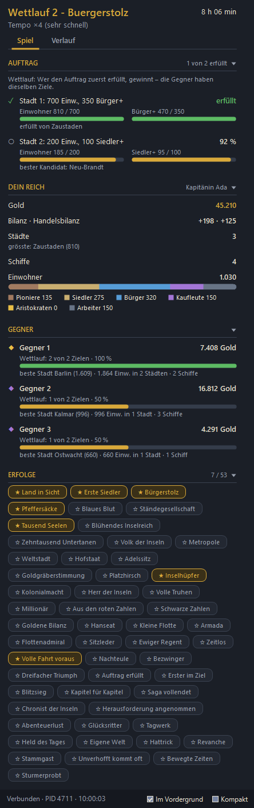
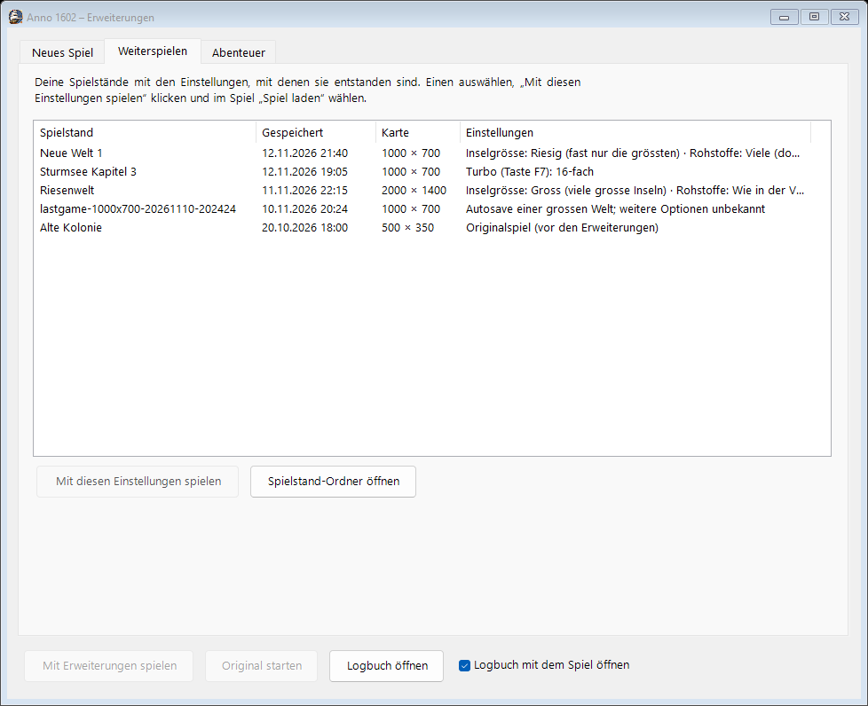
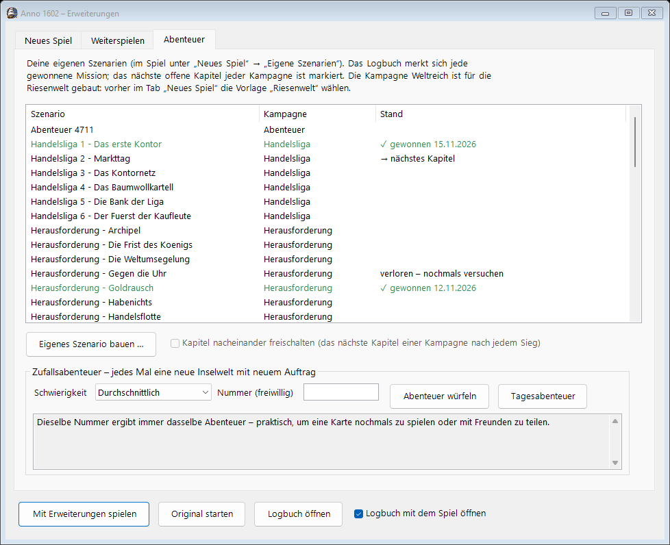
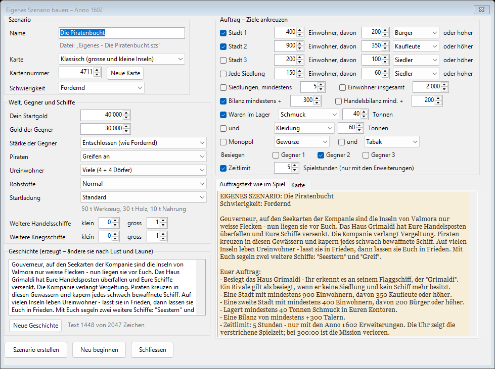
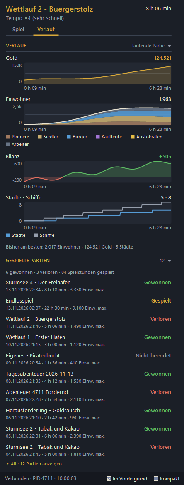
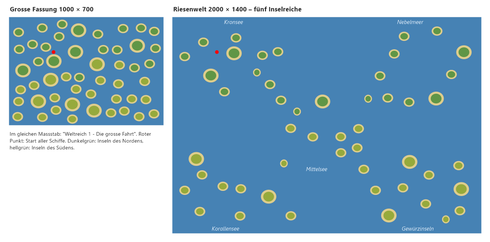

# Anno 1602 – Erweiterungen

[](https://github.com/MisterDeeds/anno1602-extensions/releases/latest)
[](LICENSE)

*[English version](README.md)*

Ein Fan-Projekt für **Anno 1602 History Edition** (Ubisoft Connect): grössere Welt, mehr Inseln,
stärkere Gegner, günstigeres Bauen und reichere Städte, Turbo bis 16-fach, zufällige Ereignisse
während des Spiels, 49 eigene Szenarien mit Geschichte und Auftrag (sechs Kampagnen – eine davon für die
Riesenwelt gebaut – und 15 Herausforderungen, einige gegen die Uhr), ein Szenario-Baukasten, Zufalls- und Tagesabenteuer und
ein Logbuch-Fenster mit Verlaufskurven neben dem Spiel.

Das Werkzeug ändert **keine Datei des Spiels**. Es passt nur den Arbeitsspeicher des laufenden
Spiels an. Wird das Spiel beendet, ist alles wieder wie im Original. Nur für das Einzelspiel.

Das Startfenster ist auf einem deutschen Windows deutsch, sonst englisch. Die Szenarien werden in
derselben Sprache gebaut: deutsche Titel und Auftragstexte auf einem deutschen Windows, englische
auf einem englischen.

<p align="center">
  
  
</p>

## Installieren

Du brauchst Windows 10 oder 11 und Anno 1602 History Edition, installiert über Ubisoft Connect.

1. Die **Windows-Taste** drücken, `powershell` tippen und **Enter** drücken.
2. Diese Zeile kopieren, ins Fenster einfügen (**Strg+V** bzw. **Ctrl+V** oder Rechtsklick) und **Enter** drücken:

   ```powershell
   irm https://raw.githubusercontent.com/MisterDeeds/anno1602-extensions/main/get.ps1 | iex
   ```

3. Das war's – der Starter öffnet sich. Ab jetzt startest du das Spiel über **„Anno 1602 - Erweiterungen“** im
   Startmenü oder auf dem Desktop (auf einem Windows in anderer Sprache: „Anno 1602 - Extensions“).

- **Aktualisieren:** Gibt es eine neue Version, zeigt der Starter den Knopf *Jetzt aktualisieren*. Oder die gleiche
  Zeile nochmals ausführen.
- **Entfernen:** Windows-Einstellungen → **Apps** → „Anno 1602 – Erweiterungen“ → *Deinstallieren*. Spiel und
  Spielstände bleiben, wie sie sind.
- Keine Administratorrechte, nichts im Spielordner. Was die Zeile macht: [get.ps1](get.ps1) lädt die
  [neuste Version](https://github.com/MisterDeeds/anno1602-extensions/releases/latest), führt
  [src/install.ps1](src/install.ps1) aus und öffnet den Starter.

<details>
<summary>Ohne PowerShell: aus dem ZIP installieren</summary>

1. Das Quellcode-ZIP der [neusten Version](https://github.com/MisterDeeds/anno1602-extensions/releases/latest)
   herunterladen und entpacken.
2. Im entpackten Ordner `install.cmd` doppelklicken. Zeigt Windows „Der Computer wurde durch Windows geschützt“:
   *Weitere Informationen → Trotzdem ausführen*. Am Schluss öffnet sich der Starter.
3. Entfernen mit `uninstall.cmd` im selben Ordner oder über Windows-Einstellungen → Apps.
</details>

## Was es kann

| Option | Wirkung |
|---|---|
| Kartengrösse | bis 2000 × 1400 Felder (Original 500 × 350) |
| Inseln | bis 50 Inseln über die ganze Karte verteilt (das Maximum des Spiels) |
| Inselgrösse | Gross / Riesig: viel mehr grosse Inseln (bis 10 der grössten, 100 × 90) |
| Rohstoffe | Mehr: Erz, Gold, Fruchtbarkeit und Schätze passend zur Inselzahl; Viele: doppelt |
| Ureinwohner | 4 + 4 oder 7 + 7 Dörfer statt 2 + 2 |
| Fruchtbarkeit | jede Pflanze auf jeder Insel (neue Endlosspiele) |
| Freie Händler | doppelt oder dreimal so viele Händlerschiffe (höchstens 24) |
| Computergegner | immer wie „Schwer“, auch wenn du leichter spielst |
| Piraten | wie Schwierigkeit / greifen immer an / stark / keine; Flotte bis 12 Schiffe statt 4 |
| Katastrophen | keine (kein Feuer, keine Pest, Dürre oder Vulkan) oder häufiger |
| Gold | Startgold für dich und für die Gegner |
| Einwohner je Haus | ×1,5 bis ×5 |
| Produktion, Schiffstempo, Laderaum | ×1,5 bis ×3 |
| Lager je Ware | ×2 bis ×5 |
| Baukosten | ×0,75, halb, ein Viertel oder gratis (Gold, Werkzeug, Holz und Ziegel; auch für die Gegner) |
| Betriebskosten | ×0,75, halb, ein Viertel oder keine |
| Steuereinnahmen | ×1,5 bis ×3 |
| Einflussradius | ×1,5 oder ×2 für Kontor, Markt und öffentliche Bauten (Kapelle, Kirche, Wirtshaus, Arzt, Schule …) |
| Erz- und Goldminen | unerschöpflich |
| Ereignisse | zufällige Ereignisse während des Spiels, selten oder häufig (siehe [Ereignisse](#ereignisse)) |
| Turbo (F7) | 8-, 12- oder 16-fache Geschwindigkeit |

## Das Startfenster

Das Startfenster hat drei Registerkarten:

<p align="center">
  
  
</p>

- **Neues Spiel**: alle Optionen zum Anklicken, in vier Gruppen (Welt, Wirtschaft, Gegner und
  Gefahren – mit den Ereignissen –, Schiffe und Tempo), dazu sechs Vorlagen:

  | Vorlage | Einstellungen |
  |---|---|
  | **Alles gross** | 1000 × 700, riesige Inseln, viele Rohstoffe, 7 + 7 Dörfer, dreimal so viele Händler, Gegner wie „Schwer“ mit 60 000 Gold, Piraten greifen an mit bis zu 8 Schiffen, Einwohner ×5, Lager ×5, Laderaum ×3, Produktion und Schiffe ×2, Turbo 16-fach, dein Gold 50 000 |
  | **Für Kampagnen** | grosse Karte und Turbo 16-fach, alles andere wie im Szenario vorgesehen |
  | **Riesenwelt** | 2000 × 1400 für die Karten der [Riesenwelt](#riesenwelt), Schiffe ×2 für die langen Seewege, Turbo 16-fach, alles andere wie im Szenario vorgesehen |
  | **Gemütlich** | Bau- und Betriebskosten halbiert, Steuern ×2, Radius ×1,5, jede Pflanze überall, unerschöpfliche Minen, keine Piraten, keine Katastrophen, 100 000 Gold, Einwohner ×2, Produktion ×2, Lager ×3, grosse Inseln, viele Rohstoffe, Turbo 16-fach |
  | **Harte Probe** | Gegner wie „Schwer“ mit 100 000 Gold, starke Piraten mit bis zu 12 Schiffen, mehr Katastrophen, 4 + 4 Dörfer, Turbo 16-fach |
  | **Alles auf Standard** | 1000 × 700 mit mehr Inseln und mehr Rohstoffen, sonst wie im Original |

- **Weiterspielen**: deine Spielstände mit den Einstellungen, mit denen sie entstanden sind.
  *Mit diesen Einstellungen spielen* startet das Spiel mit genau diesen Optionen, so wird eine
  grosse Welt immer mit der richtigen Grösse geladen. (Gemerkt für jeden Spielstand, der mit dieser
  Version der Erweiterungen gespeichert wird; bei älteren Autosaves einer grossen Welt kommt die
  Grösse aus dem Dateinamen.)
- **Abenteuer**: alle Kampagnen und Herausforderungen mit deinem Fortschritt (gewonnen, verloren,
  nächstes Kapitel), dazu
  - der **Zufallsabenteuer**-Generator: Schwierigkeit wählen, freiwillig eine Nummer eingeben,
    *Abenteuer würfeln* klicken. Jede Nummer ergibt eine eigene Inselwelt mit eigenem Auftrag (eine
    von drei Kartenarten, und Städte, ein Inselreich, Handel, ein Monopol oder Eroberung als
    Hauptziel); dieselbe Nummer ergibt immer dasselbe Abenteuer.
  - das **Tagesabenteuer**: jeden Tag ein neues Abenteuer, an diesem Tag für alle dasselbe
    („Tagesabenteuer 2026-11-15“).
  - **Eigenes Szenario bauen**: der Szenario-Baukasten (unten).
  - **Kapitel nacheinander freischalten** (zu Beginn aus): Die Liste im Spiel zeigt dann jede
    Kampagne nur bis zum ersten noch nicht gewonnenen Kapitel; das nächste kommt nach einem Sieg dazu.
    Gesperrte Kapitel tragen im Startfenster ein Schloss.

Unter den Registerkarten: **Mit Erweiterungen spielen**, **Original starten** und **Logbuch öffnen**.

## Szenario-Baukasten

<p align="center">
  
</p>

Ein Szenario zum Zusammenklicken: Name, Karte (klassisch, Archipel oder Kontinente, jede
Kartennummer eine eigene Welt), Schwierigkeit, dein Gold und Gold und Stärke der Gegner, Piraten,
Ureinwohner, Rohstoffe, Startladung und bis zu drei weitere Schiffe, dazu der Auftrag – Städte mit
einer Stufe, jede Siedlung mindestens, Zahl der Siedlungen, Einwohner insgesamt, Bilanz,
Handelsbilanz, Waren im Lager, Monopole, bestimmte Gegner besiegen und auf Wunsch ein Zeitlimit. Mit dem Häkchen
*auch für die Riesenwelt* bekommt das Szenario eine dritte Karte mit fünf Inselreichen für 2000 × 1400
([Riesenwelt](#riesenwelt)). Den Auftragstext schreibt der Baukasten (mit einer Geschichte, die du ändern kannst) und zeigt ihn genau
so, wie ihn das Spiel zeigen wird. *Szenario erstellen* legt ihn als „Eigenes - &lt;Name&gt;“ zu deinen
eigenen Szenarien. Die Karten folgen denselben Regeln wie die Kampagnen, so finden die Gegner immer
Platz.

## Ereignisse

Mit **Ereignisse** auf *Selten* (etwa alle drei Spielstunden) oder *Häufig* (etwa jede Spielstunde)
passiert ab und zu etwas, sobald du eine Stadt hast:

| Ereignis | Wirkung |
|---|---|
| Ein Gönner | Gold für deine Kolonie (2000 bis 10 000, mehr, je weiter deine Städte sind) |
| Brand im Kontor | die Reparatur kostet 5 % deines Golds |
| Geschenk eines Händlers | 10 bis 30 t Werkzeug, Holz, Ziegel oder Nahrung in deiner grössten Stadt |
| Steuersegen / Steuerflaute | Steuern +50 % / −25 % für eine Spielstunde (auch bei den Gegnern) |
| Erntesegen / Sumpffieber | alle Felder und Betriebe 50 % schneller / 25 % langsamer für eine Spielstunde (auch bei den Gegnern) |

Das Fenster des Werkzeugs muss während des Spiels offen bleiben; es stellt Steuern und Produktion
nach der Stunde wieder her, ebenso beim Laden oder Starten eines anderen Spiels und beim Spielende.
Spielstände enthalten die vorübergehenden Werte nie. Jedes Ereignis erscheint auch im Logbuch.

## Logbuch

<p align="center">
  
  
</p>

Ein Fenster neben dem Spiel. Es *liest* nur den Arbeitsspeicher des Spiels.
- **Spiel**: deine Auftragsziele mit laufenden Fortschrittsbalken (und der verbleibenden Zeit, wenn
  der Auftrag ein Zeitlimit hat), Gold, Bilanz und Handelsbilanz, deine Städte und Einwohner je
  Stufe, Schiffe, die besten Städte der Gegner (und ihr Stand im Wettlauf), die Ereignisse dieser
  Partie und 53 Erfolge – von „Land in Sicht“ (erste Stadt) über „Saga vollendet“ (eine ganze
  Kampagne) bis „Stammgast“ (zehn Partien).
- **Verlauf**: Kurven von Gold, Einwohnern je Stufe, Bilanz, Städten und Schiffen über die Partie
  (ein Punkt je Spielminute) und die Liste deiner gespielten Partien mit Dauer, Ergebnis und den
  meisten Einwohnern. Am Ende jeder Partie zeigt eine Karte, was du erreicht hast.

Erfolge, beendete Aufträge und gespielte Partien stehen in
`%APPDATA%\Anno1602-Extensions\logbook.json`, die Kurven in `history\`; daraus zeigt die
Registerkarte „Abenteuer“, welche Kapitel du gewonnen hast. Das Spiel im Fenstermodus oder einen
zweiten Bildschirm nutzen, um beides zu sehen.

Im laufenden Spiel geprüft am 12. November 2026: Alle sieben neuen Optionen werden genau wie geplant
gesetzt (alle 50 Inseln tragen alle sechs Pflanzen; bei 16-fach über 1,5 Spielstunden blieben die
Erzvorkommen gleich, es gab keine Katastrophe, und das Gold der Gegner stieg mit doppelten Steuern und
halben Betriebskosten), die Registerkarte „Weiterspielen“ (ein Spielstand wird beim Spielende mit seinen
Optionen gemerkt), Sturmsee 1 und 5, Archipel und ein Zufallsabenteuer (Ladung, Flotte und Auftrag wie
geplant) sowie das Logbuch (Live-Werte, eine gewonnene Mission wird eingetragen). Später am selben
Tag: Das Baumenü zeigt die halbierten Kosten, ein Wegstück kostete wirklich 3 statt 5 Gold; die
Bauvorschau des Marktplatzes zeigt den doppelten Radius; mit demselben Spielstand über 2,9 Spielstunden
ergaben die Katastrophen 0 / 34 / 89 neue Brände und Pestfälle für aus / normal / häufiger; ein
englisches Szenario erscheint mit englischem Text; alle Knöpfe des Startfensters wurden im Code
geklickt.

Im laufenden Spiel geprüft am 15. November 2026 (Version 3.0.0): „Gegen die Uhr“ startet mit seinem
Zeitlimit von 3 Stunden, das Spiel zeigt seine eigene Uhr, nach dem Laden des Spielstands ist das
Limit wieder da, und läuft die Zeit ab, ist der Auftrag verloren; Ereignisse (Gönner, Brand,
Händlergeschenk, Erntesegen, Sumpffieber) ändern Gold, Waren und Produktion genau wie angekündigt und
stellen sie am Ende oder mit dem Spielende wieder her; in „Neue Welt 3“ siedeln alle drei Gegner
zwischen den 14 Dörfern der Ureinwohner; ein Szenario aus dem Baukasten lädt mit Zeitlimit, weiteren
Schiffen und dem genannten Gegner. Noch nicht durchgespielt: die Balance der mit † markierten
Szenarien.

Im laufenden Spiel geprüft am 15. November 2026 (Version 3.1.0): Mit der Vorlage *Riesenwelt* lädt
„Weltreich 1“ alle 50 Inseln genau dort, wo die Riesenwelt-Karte sie hinlegt (10 mit 100 × 90, 35 mit
70 × 60, 5 mit 50 × 52 auf 2000 × 1400), und nach über einer Spielstunde mit 16-fach haben alle drei
Gegner gesiedelt, zwei davon in fernen Reichen; bei 1000 × 700 gilt die grosse Fassung, und das
Originalspiel ohne Erweiterungen spielt dieselbe Datei auf seiner klassischen Karte mit 18 Inseln.

## Kampagnen und Herausforderungen

49 eigene Szenarien, im Spiel unter *Einzelspieler → Neues Spiel → Eigene Szenarien*. Jedes hat
eine klassische Karte (500 × 350) und eine grosse Fassung (1000 × 700, bis 50 Inseln); das Weltreich
und die mit 🌍 markierten Herausforderungen dazu eine Riesenwelt-Fassung (2000 × 1400, siehe
[Riesenwelt](#riesenwelt)).

| Deutscher Titel | Englischer Titel | Auftrag |
|---|---|---|
| **Die Smaragdinseln** 1 Landung | **Emerald Isles** 1 Landfall | Stadt mit 250 Einwohnern (150 Siedler), Bilanz im Plus |
| 2 Gewürzfieber | 2 Spice Fever | Gewürzmonopol, 500 Einwohner (250 Bürger) |
| 3 Zwei Kolonien | 3 Two Colonies | 800 Einw. (300 Kaufleute) und 500 Einw. (250 Bürger), Bilanz +300 |
| 4 Schwarze Segel | 4 Black Sails | 1000 Einw. (500 Kaufleute), 20 t Kanonen, 40 t Musketen, Piraten |
| 5 Der Eroberer | 5 The Conqueror | alle drei Rivalen besiegen, Piraten |
| 6 Krone der Inseln | 6 Crown of the Isles | 3 Städte, die grösste 2500 Einw. (1200 Aristokraten), Bilanz +1000 |
| **Wettlauf der Häuser** 1 Erster Hafen | **Race** 1 First Harbour | 300 Einw. (150 Siedler) – die Rivalen haben denselben Auftrag |
| 2 Bürgerstolz | 2 Civic Pride | 700 Einw. (350 Bürger) und eine zweite Stadt mit 200 Einw. (100 Siedler) |
| 3 Kaufmannsrepublik | 3 Merchant Republic | 1000 Einw. (400 Kaufleute), Piraten |
| 4 Die Krone | 4 The Crown | 1500 Einw. (600 Aristokraten), Bilanz +500, Piraten |
| **Die Sturmsee** 1 Schiffbruch † | **Storm Sea** 1 Shipwreck † | Stadt mit 200 Einw. (100 Siedler) und eine zweite Siedlung, Bilanz im Plus – mit wenig Gold und halb leerem Schiff |
| 2 Tabak und Kakao † | 2 Tobacco and Cocoa † | Tabakmonopol und Kakaomonopol, 600 Einw. (300 Bürger) |
| 3 Der Freihafen † | 3 The Free Port † | Handelsbilanz +400, 40 t Tabakwaren und 40 t Kakao im Lager |
| 4 Die Rote Flagge † | 4 The Red Flag † | mindestens 3 Siedlungen, jede mit 300 Einw. (100 Bürger), Piraten |
| 5 Verrat † | 5 Betrayal † | das Haus Valcourt besiegen (nur diesen Rivalen), 1000 Einw. (400 Kaufleute) |
| 6 Das Goldene Zeitalter † | 6 The Golden Age † | 2000 Einw. (800 Aristokraten) und 1200 (500 Kaufleute), zusammen 4000, 40 t Schmuck, Bilanz +800, Piraten |
| **Die Neue Welt** 1 Die Überfahrt † | **The New World** 1 The Crossing † | Stadt mit 300 Einw. (150 Siedler), 3 Siedlungen, Bilanz im Plus |
| 2 Zucker und Rum † | 2 Sugar and Rum † | Zuckermonopol, 40 t Alkohol im Lager, 500 Einw. (200 Bürger) |
| 3 Land der vielen Völker † | 3 Land of Many Peoples † | 800 Einw. (300 Kaufleute), 4 Siedlungen, jede mit 200 Einw. (80 Siedler) – auf grossen Inseln voller Dörfer der Ureinwohner |
| 4 Die Schatzflotte † | 4 The Treasure Fleet † | 60 t Gewürze und 40 t Gold im Lager, Handelsbilanz +300, Piraten |
| 5 Der Konquistador † | 5 The Conquistador † | das Haus Valdoro besiegen (nur diesen Rivalen), 4 Siedlungen, zusammen 2500 Einw. |
| 6 Der Vizekönig † | 6 The Viceroy † | 2000 Einw. (800 Aristokraten), 1200 (500 Kaufleute) und 600 (250 Bürger), 6 Siedlungen, Bilanz +800, Piraten |
| **Die Handelsliga** 1 Das erste Kontor † | **The Trade League** 1 The First Warehouse † | 250 Einw. (120 Siedler), 30 t Stoffe im Lager, Handelsbilanz +100 – kein Krieg in dieser Kampagne |
| 2 Markttag † | 2 Market Day † | 500 Einw. (200 Bürger), 40 t Tabakwaren und 40 t Gewürze im Lager |
| 3 Das Kontornetz † | 3 The Warehouse Network † | 6 Siedlungen, jede mit 150 Einw. (60 Siedler), Handelsbilanz +200 |
| 4 Das Baumwollkartell † | 4 The Cotton Cartel † | Baumwollmonopol, 50 t Kleidung im Lager, Handelsbilanz +300, Piraten |
| 5 Die Bank der Liga † | 5 The League Bank † | 1200 Einw. (600 Kaufleute), Bilanz +500, Handelsbilanz +400 |
| 6 Der Fürst der Kaufleute † | 6 The Merchant Prince † | 2000 Einw. (700 Aristokraten), 50 t Schmuck im Lager, Handelsbilanz +500, Bilanz +800, Piraten |
| **Das Weltreich** 1 Die grosse Fahrt † 🌍 | **The World Empire** 1 The Great Voyage † 🌍 | 500 Einw. (250 Siedler), 3 Siedlungen, 900 Einw. insgesamt |
| 2 Das Nebelmeer † 🌍 | 2 The Mist Sea † 🌍 | 50 t Stoffe und 40 t Tabakwaren im Lager, 800 Einw. (300 Bürger), 4 Siedlungen |
| 3 Die Gewürzroute † 🌍 | 3 The Spice Route † 🌍 | 60 t Gewürze im Lager, Handelsbilanz +250, 1200 Einw. (400 Kaufleute), Piraten |
| 4 Die Korallensee † 🌍 | 4 The Coral Sea † 🌍 | Baumwoll- und Kakaomonopol, 5 Siedlungen mit zusammen 3000 Einw., Piraten |
| 5 Krieg der Kronen † 🌍 | 5 War of the Crowns † 🌍 | Haus Morvan besiegen (nur diesen Rivalen), 5 Siedlungen, 4000 Einw. insgesamt |
| 6 Das Weltreich † 🌍 | 6 The World Empire † 🌍 | 3000 Einw. (1200 Aristokraten), 2000 (800 Kaufleute) und 1200 (500 Bürger), 7 Siedlungen, 8000 insgesamt, Bilanz +1500, Piraten |
| **Herausforderung** Inselreich | **Challenge** Island Realm | 8 eigene Siedlungen mit zusammen 3000 Einwohnern |
| Handelsimperium | Trade Empire | 50 t Schmuck und 80 t Kleidung im Lager, Handelsbilanz +300 |
| Goldrausch | Gold Rush | 60 t Gold und 40 t Schmuck im Lager, Piraten |
| Archipel † | Archipelago † | mindestens 10 Siedlungen auf kleinen Inseln, jede mit 100 Einw. (40 Siedler) |
| Kontinente † | Continents † | 1500 Einw. (400 Aristokraten), zusammen 3000, Bilanz +300 – auf wenigen riesigen Inseln |
| Handelsflotte † | Merchant Fleet † | 4 Siedlungen, 60 t Gewürze und 60 t Kakao im Lager – vier Schiffe, wenig Gold |
| Seemacht † | Sea Power † | alle drei Rivalen besiegen – sie sind arm, du startest mit drei Kriegsschiffen |
| Kolonialherr † | Colonial Lord † | Weinmonopol (Norden) und Kakaomonopol (Süden), 4 Siedlungen, jede mit 250 Einw. (80 Bürger) |
| Monopolist † | Monopolist † | Gewürz- und Tabakmonopol, Handelsbilanz +400 – gegen drei reiche, rücksichtslose Rivalen |
| Ruhige See † | Calm Seas † | 1200 Einw. (500 Kaufleute), zusammen 2500, Bilanz +300 – keine Piraten, aber karge Inseln und reiche Rivalen |
| Habenichts † | Shoestring † | 600 Einw. (250 Bürger), Bilanz +200 – mit 8000 Gold und fast leerem Schiff |
| Gegen die Uhr † ⏱ | Against the Clock † ⏱ | 500 Einw. (250 Siedler) in 3 Stunden |
| Die Frist des Königs † ⏱ | The Royal Deadline † ⏱ | 1000 Einw. (400 Bürger) und Bilanz +300 in 6 Stunden, Piraten |
| Sieben Meere † 🌍 | Seven Seas † 🌍 | 7 Siedlungen, jede mit 300 Einw. (120 Siedler), 4000 insgesamt, Bilanz +300, Piraten |
| Die Weltumsegelung † 🌍 | Around the World † 🌍 | Weinmonopol (Norden) und Gewürzmonopol (Süden), Handelsbilanz +400, Piraten |

† Neu im November 2026 und noch nicht im Spiel auf die Balance geprüft: Die Schwierigkeit ist in
Anlehnung an die gemessenen Kapitel ausgelegt.

⏱ Mit Zeitlimit: Es zählt in Stunden der spieleigenen Uhr, die das Spiel unten links zeigt, sobald
ein Limit gesetzt ist (bei 180:00 sind drei Stunden um); Pause hält sie an, der Turbo beschleunigt
sie. Das Limit gilt nur, wenn das Spiel mit den Erweiterungen läuft (sie setzen es bei jedem Start
und jedem Laden); ohne sie hat das Szenario kein Limit.

🌍 Für die Riesenwelt gebaut: am besten mit der Vorlage *Riesenwelt*; bei einer kleineren Karte gilt
die grosse oder die klassische Fassung.

Im Wettlauf gewinnt, wer den Auftrag zuerst erfüllt. Gemessen ohne Zutun des Spielers: Die Rivalen
schaffen Kapitel 1 nach rund 5, Kapitel 2 nach rund 7½, Kapitel 3 nach rund 8 und Kapitel 4 nach
rund 20 Stunden Spielzeit.

Die Szenarien liegen nicht in diesem Repository. Der Installer baut sie aus den Endlos-Vorlagen
deines eigenen Spiels (`src/build-scenarios.ps1`).

## Riesenwelt

<p align="center">
  
</p>

Das Spiel kennt höchstens 50 Inseln und davon höchstens 10 der grössten Sorte (100 × 90) – mehr Land
trägt keine Karte, egal wie gross sie ist. Gleichmässig über 2000 × 1400 verteilt, wären 50 Inseln fast
nur Wasser. Die Riesenwelt-Karten fassen sie deshalb zu **fünf Inselreichen** zusammen, mit offenem Meer
dazwischen: die Kronsee im Nordwesten, wo alle Schiffe starten, das Nebelmeer im Nordosten, die
Mittelsee, die Korallensee im Südwesten und die Gewürzinseln im Südosten. Jedes Reich hat 8 bis 11
Inseln – zusammen 10 mit 100 × 90, 35 mit 70 × 60 und 5 mit 50 × 52 –, im Norden mit nördlichem und im
Süden mit südlichem Klima: Tabak, Zuckerrohr und Wein wachsen nahe der Heimat, Gewürze, Kakao und
Baumwolle erst nach einer langen Seereise. Jedes Szenario bekommt seine eigene Form der Reiche.

Gespielt wird mit der Vorlage **Riesenwelt**: Karte 2000 × 1400, Schiffe doppelt so schnell, Turbo
16-fach. Die Szenarien haben weiterhin die klassische Karte und die Fassung für 1000 × 700, und das
Werkzeug nimmt immer die grösste Fassung, die zur gewählten Kartengrösse passt; ohne die Erweiterungen
gilt die klassische Karte. Ältere Szenarien werden wie bisher auf 2000 × 1400 gestreckt.

## Wichtig

- Spielstände aus der grossen Welt nur mit den Erweiterungen und derselben Kartengrösse laden –
  am einfachsten über die Registerkarte **Weiterspielen**. Der Spielstand selbst speichert die
  Grösse nicht.
- Das Werkzeug benennt den automatischen Spielstand („Spiel fortsetzen“) einer grossen Welt nach
  dem Spielende um, damit ihn das Spiel ohne Erweiterungen nicht lädt.
- Vor jedem Start sichert das Werkzeug den Ordner `Dokumente\Anno 1602 History Edition\Savegame` (nur wenn
  sich etwas geändert hat). Es behält die allererste und die fünf neuesten Sicherungen; ältere wandern in den
  Papierkorb.
- Über das Startfenster gestartet, schliesst sich das Fenster des Werkzeugs nach dem Spiel von selbst; offen
  bleibt es nur, wenn etwas schiefging, damit du die Meldung lesen kannst. Lass es während des Spiels
  offen: Es führt die Ereignisse aus und schützt den automatischen Spielstand einer grossen Welt.
- Getestet mit genau einer Spielversion (SHA-256 von `Anno1602.exe` beginnt mit `7731972f`).
  Nach einem Update des Spiels bricht das Werkzeug ab, ohne etwas zu ändern.
- Der Starter fragt bei jedem Start im Hintergrund bei GitHub nach der Nummer der neusten Version. Sonst wird
  nichts gesendet.

## Aufbau

```
anno1602-extensions/
├── get.ps1                        der Einzeiler-Installer (irm … | iex): neuste Version, installieren, Starter
├── install.cmd, uninstall.cmd     aus einer entpackten Kopie installieren oder entfernen (Doppelklick)
├── src/                           alles, was installiert wird (läuft aus einem Ordner)
│   ├── anno-patcher.ps1           das Werkzeug: prüft die Spielversion und patcht den Speicher
│   ├── launcher.ps1               das Startfenster (deutsch oder englisch, je nach Windows)
│   ├── logbook.ps1                das Logbuch-Fenster (liest den Speicher des Spiels nur)
│   ├── build-scenarios.ps1        baut die 49 Szenarien deutsch oder englisch
│   ├── scenario-lib.ps1           Dateiformat .szs und Aufträge AUFTRAG4 (entschlüsselt)
│   ├── random-adventure.ps1       Generator für Zufalls- und Tagesabenteuer (Nummer + Schwierigkeit)
│   ├── scenario-designer.ps1      das Fenster des Szenario-Baukastens
│   ├── install.ps1                Installer hinter get.ps1, install.cmd, uninstall.cmd und der Apps-Liste
│   └── README.txt, README.de.txt  Anleitung, wird neben dem Werkzeug installiert
├── tests/
│   ├── test-patcher.ps1           Prüfung ohne Spiel: lädt die exe als Abbild, prüft jede Patchstelle und die Ereignisse (655 Prüfungen)
│   ├── check-scenarios.ps1        prüft gebaute Szenarien, Zufalls- und Tagesabenteuer (-Reproduce)
│   └── test-install.ps1           installiert und entfernt echt, in einer Testumgebung, auch über get.ps1 (40 Prüfungen)
├── dev/                           Hilfen für die Entwicklung
│   ├── check-game.ps1             zeigt die gepatchten Werte im laufenden Spiel (nur lesend)
│   ├── check-islands.ps1          Inseln, Erz und Fruchtbarkeit im laufenden Spiel
│   ├── show-island-plan.ps1       zeichnet die geplante Inselverteilung als Bild
│   ├── cod.ps1                    ent- und verschlüsselt die .cod-Dateien des Spiels
│   └── ghidra-scan.cmd, ghidra_scripts/   Ghidra-Auswertung (braucht eine eigene Kopie der exe in analysis/bin)
└── docs/
    ├── FINDINGS.md                alle Fundstellen, Formate, Messungen und Testläufe (englisch)
    ├── handbook.html, handbook.de.html   Handbuch zu den Kampagnen
    └── images/                    Bilder
```

Offline-Test starten: `powershell -ExecutionPolicy Bypass -File tests\test-patcher.ps1` (braucht das installierte
Spiel; es wird nicht gestartet), Installer-Test: `tests\test-install.ps1`, Logbuch-Test:
`src\logbook.ps1 -SelfTest`. Änderungen je Version: [CHANGELOG.md](CHANGELOG.md).

## Rechtliches

Ein inoffizielles Fan-Projekt, nicht mit Ubisoft verbunden. „Anno“ ist eine Marke von Ubisoft.
Das Repository enthält keine Dateien des Spiels. Du brauchst eine eigene, gekaufte Kopie.
Benutzung auf eigene Gefahr. Der Code steht unter der [MIT-Lizenz](LICENSE).
