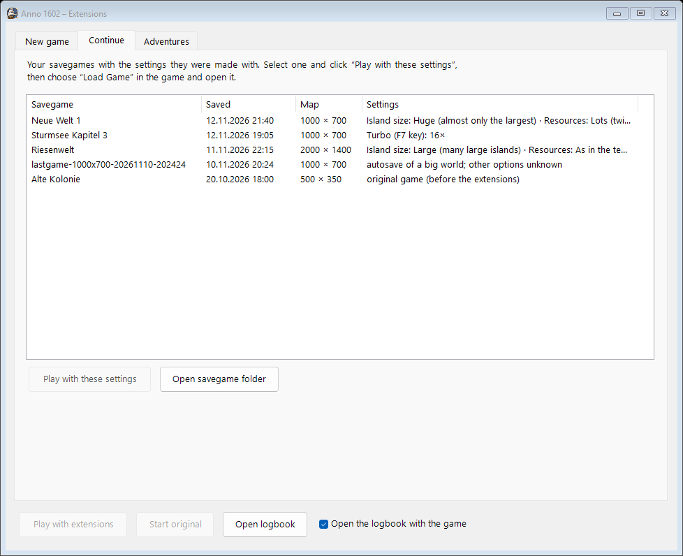
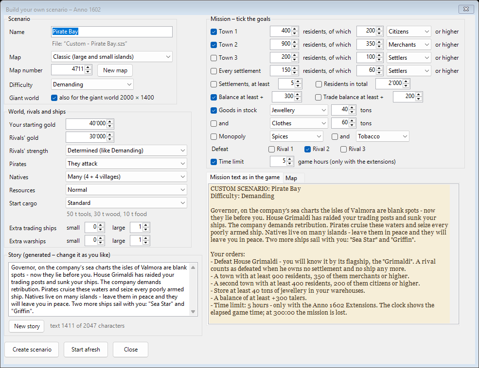
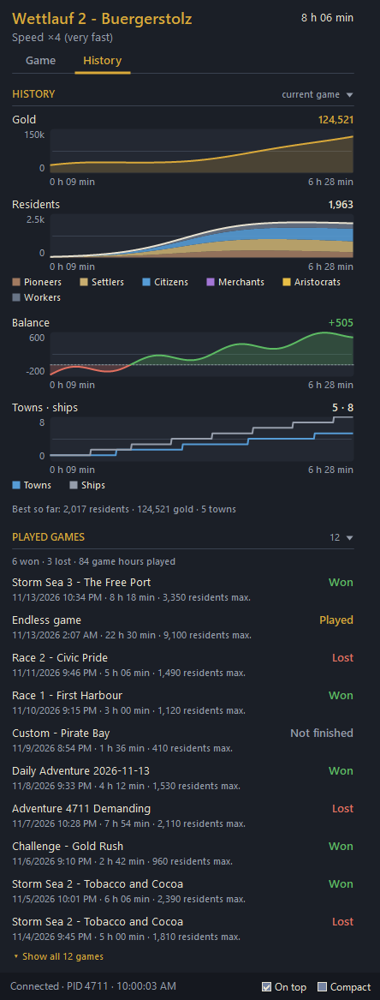
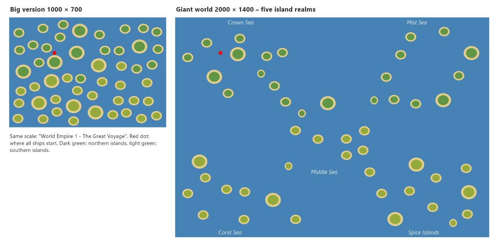

# Anno 1602 – Extensions

*[Deutsche Fassung](README.de.md)*

A fan project for **Anno 1602 History Edition** (Ubisoft Connect): a bigger world, more islands,
tougher rivals, cheaper building and richer towns, up to 16× game speed, random events while you play,
49 new scenarios with a story and a mission (six campaigns – one of them made for the giant world –
and 15 challenges, some against the clock), a scenario designer, random and daily adventures, and a logbook window with charts next to
the game.

The tool **does not change any game file**. It only patches the memory of the running game.
Quit the game and everything is back to the original. Single player only.

The launcher shows German on a German Windows and English otherwise. The scenarios are built in
the same language: English titles and mission texts on an English Windows, German ones on a
German Windows.

<p align="center">
  
  
</p>

## Features

| Option | Effect |
|---|---|
| Map size | up to 2000 × 1400 tiles (original 500 × 350) |
| Islands | up to 50 islands spread over the whole map (the game's maximum) |
| Island size | Large / Huge: many more large islands (up to 10 of the biggest, 100 × 90) |
| Resources | More: ore, gold, fertility and treasures scaled to the island count; Lots: double that |
| Natives | 4 + 4 or 7 + 7 villages instead of 2 + 2 |
| Fertility | every crop on every island (new endless games) |
| Free traders | two or three times as many trading ships (24 at most) |
| Computer rivals | always play like on "Hard", even if you pick an easier level |
| Pirates | as per difficulty / always attack / strong / none; fleet of up to 12 ships instead of 4 |
| Disasters | none (no fire, plague, drought or volcano) or more often |
| Gold | starting gold for you and for the rivals |
| Residents per house | ×1.5 to ×5 |
| Production, ship speed, cargo space | ×1.5 to ×3 |
| Storage per good | ×2 to ×5 |
| Building costs | ×0.75, half, a quarter or free (gold, tools, wood and bricks; also for the rivals) |
| Running costs | ×0.75, half, a quarter or none |
| Tax income | ×1.5 to ×3 |
| Influence radius | ×1.5 or ×2 for warehouse, market and public buildings (chapel, church, tavern, doctor, school …) |
| Ore and gold mines | inexhaustible |
| Events | random events while you play, rarely or often (see [Events](#events)) |
| Turbo (F7) | 8×, 12× or 16× game speed |

## The launcher

The launcher window has three tabs (on a German Windows: *Neues Spiel*, *Weiterspielen*, *Abenteuer*):

<p align="center">
  
  
</p>

- **New game**: every option as a click, in four groups (World, Economy, Rivals and dangers – with
  the events –, Ships and speed), plus six presets:

  | Preset | Settings |
  |---|---|
  | **Everything big** (*Alles gross*) | 1000 × 700, huge islands, lots of resources, 7 + 7 villages, three times as many traders, rivals like "Hard" with 60,000 gold, pirates attack with up to 8 ships, residents ×5, storage ×5, cargo space ×3, production and ships ×2, turbo 16×, your gold 50,000 |
  | **For campaigns** (*Für Kampagnen*) | big map and turbo 16×, everything else as the scenario intends |
  | **Giant world** (*Riesenwelt*) | 2000 × 1400 for the [giant world](#giant-world) maps, ships ×2 for the long sea routes, turbo 16×, everything else as the scenario intends |
  | **Relaxed** (*Gemütlich*) | building costs and running costs halved, taxes ×2, radius ×1.5, every crop everywhere, inexhaustible mines, no pirates, no disasters, 100,000 gold, residents ×2, production ×2, storage ×3, large islands, lots of resources, turbo 16× |
  | **Tough test** (*Harte Probe*) | rivals like "Hard" with 100,000 gold, strong pirates with up to 12 ships, more disasters, 4 + 4 villages, turbo 16× |
  | **Reset to defaults** (*Alles auf Standard*) | 1000 × 700 with more islands and more resources, everything else original |

- **Continue**: your savegames with the settings they were made with. *Play with these
  settings* starts the game with exactly those options, so a big world is always loaded with the
  right size. (Recorded for every save written with this version of the extensions; for older
  autosaves of a big world the size is taken from the file name.)
- **Adventures**: all your campaigns and challenges with your progress (won, lost, next chapter),
  and
  - the **random adventure** generator: pick a difficulty, optionally a number, click *Roll an
    adventure*. Every number gives its own island world with its own mission (one of three map
    kinds, and towns, a realm, trade, a monopoly or conquest as the main goal); the same number
    always gives the same adventure.
  - the **daily adventure**: one new adventure every day, the same for everyone on that date
    ("Daily Adventure 2026-11-15").
  - **Build your own scenario**: the scenario designer (below).
  - **Unlock chapters one by one** (off by default): the game's list then shows each campaign only
    up to the first chapter you have not won yet; the next one appears after a win. Locked
    chapters carry a lock in the launcher.

Below the tabs: **Play with extensions**, **Start original** and **Open logbook**.

## Scenario designer

<p align="center">
  
</p>

Click a scenario together: name, map (classic, archipelago or continents, each map number its own
world), difficulty, your gold and the rivals' gold and strength, pirates, natives, resources, start
cargo and up to three extra ships, and the mission – towns with a class, every settlement at least,
number of settlements, residents in total, balance, trade balance, goods in stock, monopolies,
defeating chosen rivals, and an optional time limit. Tick *also for the giant world* and the scenario
gets a third map with five island realms for 2000 × 1400 ([giant world](#giant-world)). The mission text is written for you (a story
you can change) and shown exactly as the game will show it. *Create scenario* saves it as
"Custom - &lt;name&gt;" in your own scenarios. The maps follow the same rules as the campaigns, so the
rivals always find room.

## Events

With **Events** set to *Rare* (about every three game hours) or *Often* (about every game hour),
something happens now and then once you have a town:

| Event | Effect |
|---|---|
| A patron | gold for your colony (2,000 to 10,000, more the further your towns have come) |
| Fire in the warehouse | the repairs cost 5 % of your gold |
| A trader's gift | 10 to 30 t of tools, wood, bricks or food in your biggest town |
| Tax windfall / tax slump | taxes +50 % / −25 % for one game hour (for the rivals too) |
| Bumper harvest / marsh fever | every farm and workshop 50 % faster / 25 % slower for one game hour (for the rivals too) |

The tool's window has to stay open while you play; it restores taxes and production after the
hour, when you load or start another game and when the game ends. Savegames never contain the
temporary values. Every event also appears in the logbook.

## Logbook

<p align="center">
  
  
</p>

A window next to the game. It only *reads* the game's memory.
- **Game**: your mission goals with live progress bars (and the time left if the mission has a
  time limit), gold, balance and trade balance, your towns and residents per class, ships, the
  rivals' best towns (and their progress in a race), the events of this game and 53 achievements –
  from "Land Ho!" (first town) to "Saga Complete" (a whole campaign) and "Regular" (ten games).
- **History**: charts of gold, residents per class, balance, towns and ships over the game (one
  point per game minute), and the list of your played games with time, result and most residents.
  At the end of every game a summary card shows what you reached.

Achievements, finished missions and played games are kept in
`%APPDATA%\Anno1602-Extensions\logbook.json`, the charts in `history\`; the Adventures tab shows
from it which chapters you have won. Use the game in window mode or a second monitor to see both.

Checked in the running game on 12 November 2026: all seven new options are set exactly as planned
(every one of 50 islands carries all six crops; at 16× over 1.5 game hours the ore deposits stayed
constant, no disaster struck, and the rivals' gold rose with doubled taxes and halved running costs),
the Continue tab (a savegame is noted with its options when the game ends), Storm Sea 1 and 5,
Archipelago and a random adventure (cargo, fleet and missions as designed) and the logbook (live
values, a won mission is recorded). Later the same day: the build menu shows the halved costs and a
road tile really cost 3 instead of 5 gold; the market preview shows the doubled radius; with the same
savegame over 2.9 game hours "Disasters" gave 0 / 34 / 89 new fires and plagues for off / normal /
more; an English scenario appears with its English text; all launcher buttons were clicked in code.

Checked in the running game on 15 November 2026 (version 3.0.0): "Against the Clock" starts with its
3-hour limit, the game shows its own clock, the limit is back after loading the saved game, and when
the time runs out the mission ends as lost; events (patron, fire, trader's gift, bumper harvest, marsh
fever) change gold, goods and production exactly as announced and restore them at the end or with the
game; in "The New World 3" all three rivals settle among the 14 native villages; a designer scenario
loads with its time limit, extra ships and the named rival. Not played through yet: the balance of
the scenarios marked †.

Checked in the running game on 15 November 2026 (version 3.1.0): with the preset *Giant world* "The World
Empire 1" loads all 50 islands exactly where the giant map puts them (10 of 100 × 90, 35 of 70 × 60, 5 of
50 × 52 on 2000 × 1400), and after more than one game hour at 16× all three rivals have settled, two of
them in far-off realms; at 1000 × 700 the big version applies, and the original game without the
extensions plays the same file on its classic map with 18 islands.

## Campaigns and challenges

49 new scenarios, in game under *Single Player → New Game → Own Scenarios* (*Einzelspieler →
Neues Spiel → Eigene Szenarien*). Each one has a classic map (500 × 350) and a big version
(1000 × 700, up to 50 islands); the World Empire and the challenges marked 🌍 also a giant world
version (2000 × 1400, see [Giant world](#giant-world)).

| German title | English title | Mission |
|---|---|---|
| **Die Smaragdinseln** 1 Landung | **Emerald Isles** 1 Landfall | a town of 250 residents (150 settlers), positive balance |
| 2 Gewürzfieber | 2 Spice Fever | spice monopoly, 500 residents (250 citizens) |
| 3 Zwei Kolonien | 3 Two Colonies | 800 residents (300 merchants) and 500 residents (250 citizens), balance +300 |
| 4 Schwarze Segel | 4 Black Sails | 1000 residents (500 merchants), 20 t cannons, 40 t muskets, pirates |
| 5 Der Eroberer | 5 The Conqueror | defeat all three rivals, pirates |
| 6 Krone der Inseln | 6 Crown of the Isles | 3 towns, the biggest with 2500 residents (1200 aristocrats), balance +1000 |
| **Wettlauf der Häuser** 1 Erster Hafen | **Race** 1 First Harbour | 300 residents (150 settlers) – the rivals have the same mission |
| 2 Bürgerstolz | 2 Civic Pride | 700 residents (350 citizens) and a second town of 200 (100 settlers) |
| 3 Kaufmannsrepublik | 3 Merchant Republic | 1000 residents (400 merchants), pirates |
| 4 Die Krone | 4 The Crown | 1500 residents (600 aristocrats), balance +500, pirates |
| **Die Sturmsee** 1 Schiffbruch † | **Storm Sea** 1 Shipwreck † | a town of 200 residents (100 settlers) and a second settlement, positive balance – with little gold and a half-empty ship |
| 2 Tabak und Kakao † | 2 Tobacco and Cocoa † | tobacco monopoly and cocoa monopoly, 600 residents (300 citizens) |
| 3 Der Freihafen † | 3 The Free Port † | trade balance +400, 40 t tobacco goods and 40 t cocoa in store |
| 4 Die Rote Flagge † | 4 The Red Flag † | at least 3 settlements, every one with 300 residents (100 citizens), pirates |
| 5 Verrat † | 5 Betrayal † | defeat House Valcourt (only this rival), 1000 residents (400 merchants) |
| 6 Das Goldene Zeitalter † | 6 The Golden Age † | 2000 residents (800 aristocrats) and 1200 (500 merchants), 4000 in total, 40 t jewellery, balance +800, pirates |
| **Die Neue Welt** 1 Die Überfahrt † | **The New World** 1 The Crossing † | a town of 300 residents (150 settlers), 3 settlements, positive balance |
| 2 Zucker und Rum † | 2 Sugar and Rum † | sugar monopoly, 40 t liquor in store, 500 residents (200 citizens) |
| 3 Land der vielen Völker † | 3 Land of Many Peoples † | 800 residents (300 merchants), 4 settlements, every one with 200 residents (80 settlers) – on large islands full of native villages |
| 4 Die Schatzflotte † | 4 The Treasure Fleet † | 60 t spices and 40 t gold in store, trade balance +300, pirates |
| 5 Der Konquistador † | 5 The Conquistador † | defeat House Valdoro (only this rival), 4 settlements, 2500 residents in total |
| 6 Der Vizekönig † | 6 The Viceroy † | 2000 residents (800 aristocrats), 1200 (500 merchants) and 600 (250 citizens), 6 settlements, balance +800, pirates |
| **Die Handelsliga** 1 Das erste Kontor † | **The Trade League** 1 The First Warehouse † | 250 residents (120 settlers), 30 t cloth in store, trade balance +100 – no war in this campaign |
| 2 Markttag † | 2 Market Day † | 500 residents (200 citizens), 40 t tobacco goods and 40 t spices in store |
| 3 Das Kontornetz † | 3 The Warehouse Network † | 6 settlements, every one with 150 residents (60 settlers), trade balance +200 |
| 4 Das Baumwollkartell † | 4 The Cotton Cartel † | cotton monopoly, 50 t clothes in store, trade balance +300, pirates |
| 5 Die Bank der Liga † | 5 The League Bank † | 1200 residents (600 merchants), balance +500, trade balance +400 |
| 6 Der Fürst der Kaufleute † | 6 The Merchant Prince † | 2000 residents (700 aristocrats), 50 t jewellery in store, trade balance +500, balance +800, pirates |
| **Das Weltreich** 1 Die grosse Fahrt † 🌍 | **The World Empire** 1 The Great Voyage † 🌍 | 500 residents (250 settlers), 3 settlements, 900 residents in total |
| 2 Das Nebelmeer † 🌍 | 2 The Mist Sea † 🌍 | 50 t cloth and 40 t tobacco goods in store, 800 residents (300 citizens), 4 settlements |
| 3 Die Gewürzroute † 🌍 | 3 The Spice Route † 🌍 | 60 t spices in store, trade balance +250, 1200 residents (400 merchants), pirates |
| 4 Die Korallensee † 🌍 | 4 The Coral Sea † 🌍 | cotton monopoly and cocoa monopoly, 5 settlements with 3000 residents in total, pirates |
| 5 Krieg der Kronen † 🌍 | 5 War of the Crowns † 🌍 | defeat House Morvan (only this rival), 5 settlements, 4000 residents in total |
| 6 Das Weltreich † 🌍 | 6 The World Empire † 🌍 | 3000 residents (1200 aristocrats), 2000 (800 merchants) and 1200 (500 citizens), 7 settlements, 8000 in total, balance +1500, pirates |
| **Herausforderung** Inselreich | **Challenge** Island Realm | 8 own settlements with 3000 residents in total |
| Handelsimperium | Trade Empire | 50 t jewellery and 80 t clothes in store, trade balance +300 |
| Goldrausch | Gold Rush | 60 t gold and 40 t jewellery in store, pirates |
| Archipel † | Archipelago † | at least 10 settlements on small islands, every one with 100 residents (40 settlers) |
| Kontinente † | Continents † | 1500 residents (400 aristocrats), 3000 in total, balance +300 – on a few huge islands |
| Handelsflotte † | Merchant Fleet † | 4 settlements, 60 t spices and 60 t cocoa in store – four ships, little gold |
| Seemacht † | Sea Power † | defeat all three rivals – they are poor, you start with three warships |
| Kolonialherr † | Colonial Lord † | wine monopoly (north) and cocoa monopoly (south), 4 settlements, every one with 250 residents (80 citizens) |
| Monopolist † | Monopolist † | spice and tobacco monopoly, trade balance +400 – against three rich, ruthless rivals |
| Ruhige See † | Calm Seas † | 1200 residents (500 merchants), 2500 in total, balance +300 – no pirates, but poor islands and rich rivals |
| Habenichts † | Shoestring † | 600 residents (250 citizens), balance +200 – starting with 8000 gold and an almost empty ship |
| Gegen die Uhr † ⏱ | Against the Clock † ⏱ | 500 residents (250 settlers) within 3 hours |
| Die Frist des Königs † ⏱ | The Royal Deadline † ⏱ | 1000 residents (400 citizens) and balance +300 within 6 hours, pirates |
| Sieben Meere † 🌍 | Seven Seas † 🌍 | 7 settlements, every one with 300 residents (120 settlers), 4000 in total, balance +300, pirates |
| Die Weltumsegelung † 🌍 | Around the World † 🌍 | wine monopoly (north) and spice monopoly (south), trade balance +400, pirates |

† New in November 2026 and not yet balance-tested in play: the difficulty is designed by analogy
with the measured chapters.

⏱ With a time limit: it counts in the hours of the game's own clock, which the game shows bottom
left as soon as a limit is set (at 180:00 three hours are up); pausing stops it, the turbo speeds it
up. The limit only applies when the game runs with the extensions (they set it at every start and
every load); played without them, the scenario has no limit.

🌍 Made for the giant world: best with the preset *Giant world*; with a smaller map the big or the
classic version applies.

In the race, whoever fulfils the mission first wins. Measured without any player action, the rivals
finish chapter 1 after about 5, chapter 2 after about 7½, chapter 3 after about 8 and chapter 4 after
about 20 hours of game time.

The scenarios are not part of this repository. The installer builds them from the endless-game
templates of your own copy of the game (`src/build-scenarios.ps1`).

## Giant world

<p align="center">
  
</p>

The game holds at most 50 islands, and at most 10 of the biggest kind (100 × 90) – that is all the land
a map can carry, however big it is. Spread evenly over 2000 × 1400, 50 islands would leave a mostly
empty sea. The giant world maps therefore group them into **five island realms** with open sea between
them: the Crown Sea in the north-west, where all ships start, the Mist Sea in the north-east, the Middle
Sea, the Coral Sea in the south-west and the Spice Islands in the south-east. Every realm has 8 to 11
islands – 10 of 100 × 90, 35 of 70 × 60 and 5 of 50 × 52 in all – northern climate in the north and
southern climate in the south: tobacco, sugar cane and wine grow near home, spices, cocoa and cotton
only after a long voyage. Every scenario gets its own shape of the realms.

Play them with the preset **Giant world** (*Riesenwelt*): map 2000 × 1400, ships twice as fast, turbo
16×. The scenarios still carry the classic map and the 1000 × 700 version, and the tool always takes
the biggest version that fits the chosen map size; without the extensions the classic map applies.
Older scenarios are stretched to 2000 × 1400 as before.

## Install

Requirements: Windows 10 or 11 and Anno 1602 History Edition from Ubisoft Connect.

1. Click **Code → Download ZIP** at the top and unzip it.
2. In the unzipped folder, double-click `install.cmd`. If Windows shows "Windows protected your PC":
   *More info → Run anyway*.
3. Start with **"Anno 1602 - Extensions"** in the Start menu or on the desktop
   (on a German Windows the shortcut is called "Anno 1602 - Erweiterungen").

Uninstall: double-click `uninstall.cmd` in the same folder. The game and your saves stay as they are.

## Good to know

- Load saves from a big world only with the extensions and the same map size – easiest through
  the **Continue** tab. The save itself does not store the size.
- After the game ends, the tool renames the autosave ("Continue game") of a big world, so the
  game cannot load it without the extensions.
- Before every start, the tool backs up `Documents\Anno 1602 History Edition\Savegame` (only when something
  changed). It keeps the very first backup and the newest five; older ones go to the recycle bin.
- Started from the launcher, the tool's window closes by itself after the game; it stays open only if
  something went wrong, so that you can read the message. Leave it open while you play: it runs the
  events and keeps the autosave of a big world safe.
- Tested with exactly one game version (SHA-256 of `Anno1602.exe` starts with `7731972f`).
  After a game update, the tool stops without changing anything.

## Layout

```
anno1602-extensions/
├── install.cmd, uninstall.cmd     install or remove (double-click)
├── src/                           everything that gets installed (runs from one folder)
│   ├── anno-patcher.ps1           the tool: checks the game version and patches memory
│   ├── launcher.ps1               the launcher window (German or English, following Windows)
│   ├── logbook.ps1                the logbook window (only reads the game's memory)
│   ├── build-scenarios.ps1        builds the 49 scenarios in German or English
│   ├── scenario-lib.ps1           .szs file format and AUFTRAG4 missions (decoded)
│   ├── random-adventure.ps1       random and daily adventure generator (number + difficulty)
│   ├── scenario-designer.ps1      the scenario designer window
│   ├── install.ps1                installer behind install.cmd / uninstall.cmd
│   └── README.txt, README.de.txt  player guide, installed next to the tool
├── tests/
│   ├── test-patcher.ps1           offline test: maps the game's exe as an image, checks every patch site and the events (655 checks)
│   ├── check-scenarios.ps1        checks built scenarios, random and daily adventures (-Reproduce)
│   └── test-install.ps1           installs and removes for real, in a sandbox (27 checks)
├── dev/                           helpers for development
│   ├── check-game.ps1             shows the patched values in the running game (read only)
│   ├── check-islands.ps1          islands, ore and fertility of the running game
│   ├── show-island-plan.ps1       draws the planned island layout as a picture
│   ├── cod.ps1                    decodes and encodes the game's .cod files
│   └── ghidra-scan.cmd, ghidra_scripts/   Ghidra analysis (needs your own copy of the exe in analysis/bin)
└── docs/
    ├── FINDINGS.md                every patch site, file format, measurement and test run
    ├── handbook.html, handbook.de.html   campaign handbook
    └── images/                    screenshots
```

Run the offline test: `powershell -ExecutionPolicy Bypass -File tests\test-patcher.ps1` (needs the installed
game; the game is not started), installer test: `tests\test-install.ps1`, logbook test:
`src\logbook.ps1 -SelfTest`. Changes per version: [CHANGELOG.md](CHANGELOG.md).

## Legal

An unofficial fan project, not affiliated with Ubisoft. "Anno" is a trademark of Ubisoft.
This repository contains no game files. You need your own copy of the game.
Use at your own risk. The code is released under the [MIT License](LICENSE).
