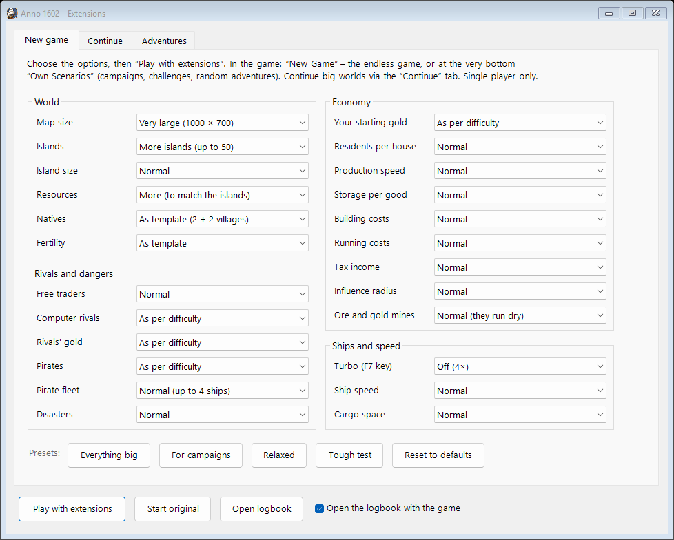
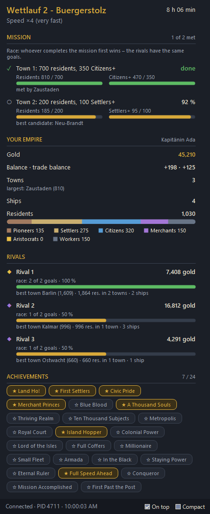
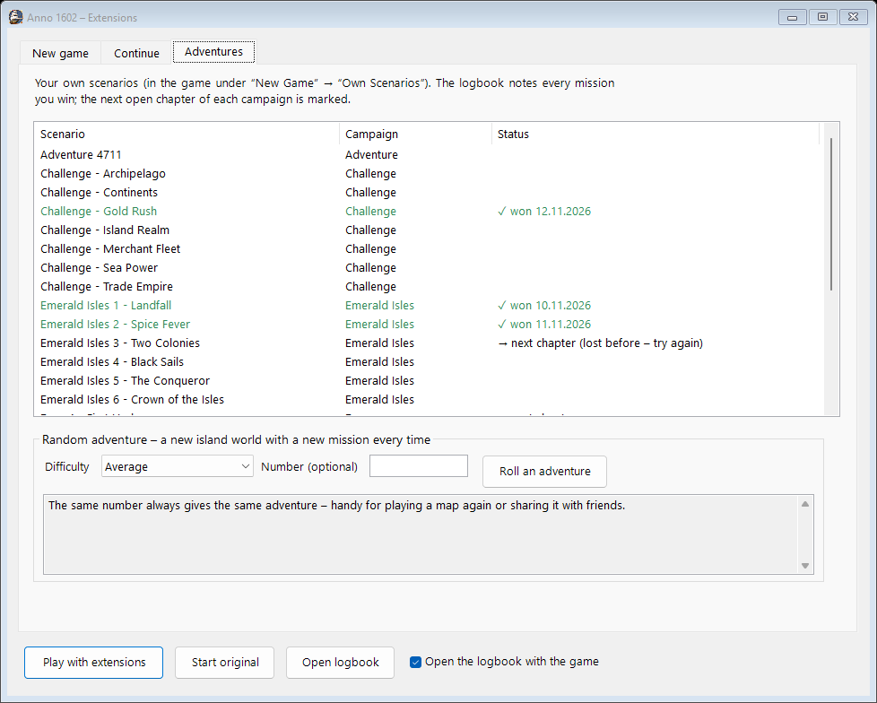

# Anno 1602 – Extensions

*[Deutsche Fassung](README.de.md)*

A fan project for **Anno 1602 History Edition** (Ubisoft Connect): a bigger world, more islands,
tougher rivals, cheaper building and richer towns, up to 16× game speed, 23 new scenarios with a
story and a mission, random adventures and a logbook window next to the game.

The tool **does not change any game file**. It only patches the memory of the running game.
Quit the game and everything is back to the original. Single player only.

The launcher shows German on a German Windows and English otherwise. The scenarios are built in
the same language: English titles and mission texts on an English Windows, German ones on a
German Windows.

<p align="center">
  
  
</p>

## Features

| Option | Effect |
|---|---|
| Map size | up to 2000 × 1400 tiles (original 500 × 350) |
| Islands | up to 50 islands spread over the whole map (the game's maximum) |
| Island size | Large / Huge: many more large islands (up to 10 of the biggest, 100 × 90) |
| Resources | More: ore, gold, fertility and treasures scaled to the island count; Lots: double that |
| Natives | 4 + 4 or 7 + 7 villages instead of 2 + 2 |
| Fertility | every crop on every island (new endless games) |
| Free traders | two or three times as many trading ships (24 at most) |
| Computer rivals | always play like on "Hard", even if you pick an easier level |
| Pirates | as per difficulty / always attack / strong / none; fleet of up to 12 ships instead of 4 |
| Disasters | none (no fire, plague, drought or volcano) or more often |
| Gold | starting gold for you and for the rivals |
| Residents per house | ×1.5 to ×5 |
| Production, ship speed, cargo space | ×1.5 to ×3 |
| Storage per good | ×2 to ×5 |
| Building costs | ×0.75, half, a quarter or free (gold, tools, wood and bricks; also for the rivals) |
| Running costs | ×0.75, half, a quarter or none |
| Tax income | ×1.5 to ×3 |
| Influence radius | ×1.5 or ×2 for warehouse, market and public buildings (chapel, church, tavern, doctor, school …) |
| Ore and gold mines | inexhaustible |
| Turbo (F7) | 8×, 12× or 16× game speed |

## The launcher

The launcher window has three tabs (on a German Windows: *Neues Spiel*, *Weiterspielen*, *Abenteuer*):

<p align="center">
  
  
</p>

- **New game**: every option as a click, in four groups (World, Economy, Rivals and dangers,
  Ships and speed), plus five presets:

  | Preset | Settings |
  |---|---|
  | **Everything big** (*Alles gross*) | 1000 × 700, huge islands, lots of resources, 7 + 7 villages, three times as many traders, rivals like "Hard" with 60,000 gold, pirates attack with up to 8 ships, residents ×5, storage ×5, cargo space ×3, production and ships ×2, turbo 16×, your gold 50,000 |
  | **For campaigns** (*Für Kampagnen*) | big map and turbo 16×, everything else as the scenario intends |
  | **Relaxed** (*Gemütlich*) | building costs and running costs halved, taxes ×2, radius ×1.5, every crop everywhere, inexhaustible mines, no pirates, no disasters, 100,000 gold, residents ×2, production ×2, storage ×3, large islands, lots of resources, turbo 16× |
  | **Tough test** (*Harte Probe*) | rivals like "Hard" with 100,000 gold, strong pirates with up to 12 ships, more disasters, 4 + 4 villages, turbo 16× |
  | **Reset to defaults** (*Alles auf Standard*) | 1000 × 700 with more islands and more resources, everything else original |

- **Continue**: your savegames with the settings they were made with. *Play with these
  settings* starts the game with exactly those options, so a big world is always loaded with the
  right size. (Recorded for every save written with this version of the extensions; for older
  autosaves of a big world the size is taken from the file name.)
- **Adventures**: all your campaigns and challenges with your progress (won, lost, next chapter),
  and the **random adventure** generator: pick a difficulty, optionally a number, click
  *Roll an adventure*. Every number gives its own island world with its own mission (one of
  three map kinds, and towns, a realm, trade, a monopoly or conquest as the main goal); the same
  number always gives the same adventure.

Below the tabs: **Play with extensions**, **Start original** and **Open logbook**.

## Logbook

A small window next to the game. It only *reads* the game's memory and shows your mission goals
with live progress bars, gold, balance and trade balance, your towns and residents per class,
ships, the rivals' best towns (and their progress in a race), and 24 achievements – from
"Land Ho!" (first town) to "Millionaire". Achievements and finished missions are kept in
`%APPDATA%\Anno1602-Extensions\logbook.json`; the Adventures tab shows from it which chapters you
have won. Use the game in window mode or a second monitor to see both.

Checked in the running game on 12 November 2026: all seven new options are set exactly as planned
(every one of 50 islands carries all six crops; at 16× over 1.5 game hours the ore deposits stayed
constant, no disaster struck, and the rivals' gold rose with doubled taxes and halved running costs),
the Continue tab (a savegame is noted with its options when the game ends), Storm Sea 1 and 5,
Archipelago and a random adventure (cargo, fleet and missions as designed) and the logbook (live
values, a won mission is recorded). Later the same day: the build menu shows the halved costs and a
road tile really cost 3 instead of 5 gold; the market preview shows the doubled radius; with the same
savegame over 2.9 game hours "Disasters" gave 0 / 34 / 89 new fires and plagues for off / normal /
more; an English scenario appears with its English text; all launcher buttons were clicked in code.
Not played through yet: the balance of the ten new scenarios.

## Campaigns and challenges

23 new scenarios, in game under *Single Player → New Game → Own Scenarios* (*Einzelspieler →
Neues Spiel → Eigene Szenarien*). Each one has a classic map (500 × 350) and a big version
(1000 × 700, up to 50 islands).

| German title | English title | Mission |
|---|---|---|
| **Die Smaragdinseln** 1 Landung | **Emerald Isles** 1 Landfall | a town of 250 residents (150 settlers), positive balance |
| 2 Gewürzfieber | 2 Spice Fever | spice monopoly, 500 residents (250 citizens) |
| 3 Zwei Kolonien | 3 Two Colonies | 800 residents (300 merchants) and 500 residents (250 citizens), balance +300 |
| 4 Schwarze Segel | 4 Black Sails | 1000 residents (500 merchants), 20 t cannons, 40 t muskets, pirates |
| 5 Der Eroberer | 5 The Conqueror | defeat all three rivals, pirates |
| 6 Krone der Inseln | 6 Crown of the Isles | 3 towns, the biggest with 2500 residents (1200 aristocrats), balance +1000 |
| **Wettlauf der Häuser** 1 Erster Hafen | **Race** 1 First Harbour | 300 residents (150 settlers) – the rivals have the same mission |
| 2 Bürgerstolz | 2 Civic Pride | 700 residents (350 citizens) and a second town of 200 (100 settlers) |
| 3 Kaufmannsrepublik | 3 Merchant Republic | 1000 residents (400 merchants), pirates |
| 4 Die Krone | 4 The Crown | 1500 residents (600 aristocrats), balance +500, pirates |
| **Die Sturmsee** 1 Schiffbruch † | **Storm Sea** 1 Shipwreck † | a town of 200 residents (100 settlers) and a second settlement, positive balance – with little gold and a half-empty ship |
| 2 Tabak und Kakao † | 2 Tobacco and Cocoa † | tobacco monopoly and cocoa monopoly, 600 residents (300 citizens) |
| 3 Der Freihafen † | 3 The Free Port † | trade balance +400, 40 t tobacco goods and 40 t cocoa in store |
| 4 Die Rote Flagge † | 4 The Red Flag † | at least 3 settlements, every one with 300 residents (100 citizens), pirates |
| 5 Verrat † | 5 Betrayal † | defeat House Valcourt (only this rival), 1000 residents (400 merchants) |
| 6 Das Goldene Zeitalter † | 6 The Golden Age † | 2000 residents (800 aristocrats) and 1200 (500 merchants), 4000 in total, 40 t jewellery, balance +800, pirates |
| **Herausforderung** Inselreich | **Challenge** Island Realm | 8 own settlements with 3000 residents in total |
| Handelsimperium | Trade Empire | 50 t jewellery and 80 t clothes in store, trade balance +300 |
| Goldrausch | Gold Rush | 60 t gold and 40 t jewellery in store, pirates |
| Archipel † | Archipelago † | at least 10 settlements on small islands, every one with 100 residents (40 settlers) |
| Kontinente † | Continents † | 1500 residents (400 aristocrats), 3000 in total, balance +300 – on a few huge islands |
| Handelsflotte † | Merchant Fleet † | 4 settlements, 60 t spices and 60 t cocoa in store – four ships, little gold |
| Seemacht † | Sea Power † | defeat all three rivals – they are poor, you start with three warships |

† New in November 2026 and not yet balance-tested in play: the difficulty is designed by analogy
with the measured chapters.

In the race, whoever fulfils the mission first wins. Measured without any player action, the rivals
finish chapter 1 after about 5, chapter 2 after about 7½, chapter 3 after about 8 and chapter 4 after
about 20 hours of game time.

The scenarios are not part of this repository. The installer builds them from the endless-game
templates of your own copy of the game (`src/build-scenarios.ps1`).

## Install

Requirements: Windows 10 or 11 and Anno 1602 History Edition from Ubisoft Connect.

1. Click **Code → Download ZIP** at the top and unzip it.
2. In the unzipped folder, double-click `install.cmd`. If Windows shows "Windows protected your PC":
   *More info → Run anyway*.
3. Start with **"Anno 1602 - Extensions"** in the Start menu or on the desktop
   (on a German Windows the shortcut is called "Anno 1602 - Erweiterungen").

Uninstall: double-click `uninstall.cmd` in the same folder. The game and your saves stay as they are.

## Good to know

- Load saves from a big world only with the extensions and the same map size – easiest through
  the **Continue** tab. The save itself does not store the size.
- After the game ends, the tool renames the autosave ("Continue game") of a big world, so the
  game cannot load it without the extensions.
- Before every start, the tool backs up `Documents\Anno 1602 History Edition\Savegame` (only when something
  changed). It keeps the very first backup and the newest five; older ones go to the recycle bin.
- Started from the launcher, the tool's window closes by itself after the game; it stays open only if
  something went wrong, so that you can read the message.
- Tested with exactly one game version (SHA-256 of `Anno1602.exe` starts with `7731972f`).
  After a game update, the tool stops without changing anything.

## Layout

```
anno1602-extensions/
├── install.cmd, uninstall.cmd     install or remove (double-click)
├── src/                           everything that gets installed (runs from one folder)
│   ├── anno-patcher.ps1           the tool: checks the game version and patches memory
│   ├── launcher.ps1               the launcher window (German or English, following Windows)
│   ├── logbook.ps1                the logbook window (only reads the game's memory)
│   ├── build-scenarios.ps1        builds the 23 scenarios in German or English
│   ├── scenario-lib.ps1           .szs file format and AUFTRAG4 missions (decoded)
│   ├── random-adventure.ps1       random adventure generator (number + difficulty)
│   ├── install.ps1                installer behind install.cmd / uninstall.cmd
│   └── README.txt, README.de.txt  player guide, installed next to the tool
├── tests/
│   ├── test-patcher.ps1           offline test: maps the game's exe as an image, checks every patch site (556 checks)
│   ├── check-scenarios.ps1        checks built scenarios and random adventures (-Reproduce)
│   └── test-install.ps1           installs and removes for real, in a sandbox (17 checks)
├── dev/                           helpers for development
│   ├── check-game.ps1             shows the patched values in the running game (read only)
│   ├── check-islands.ps1          islands, ore and fertility of the running game
│   ├── show-island-plan.ps1       draws the planned island layout as a picture
│   ├── cod.ps1                    decodes and encodes the game's .cod files
│   └── ghidra-scan.cmd, ghidra_scripts/   Ghidra analysis (needs your own copy of the exe in analysis/bin)
└── docs/
    ├── FINDINGS.md                every patch site, file format, measurement and test run
    ├── handbook.html, handbook.de.html   campaign handbook
    └── images/                    screenshots
```

Run the offline test: `powershell -ExecutionPolicy Bypass -File tests\test-patcher.ps1` (needs the installed
game; the game is not started), installer test: `tests\test-install.ps1`. Changes per version:
[CHANGELOG.md](CHANGELOG.md).

## Legal

An unofficial fan project, not affiliated with Ubisoft. "Anno" is a trademark of Ubisoft.
This repository contains no game files. You need your own copy of the game.
Use at your own risk. The code is released under the [MIT License](LICENSE).
